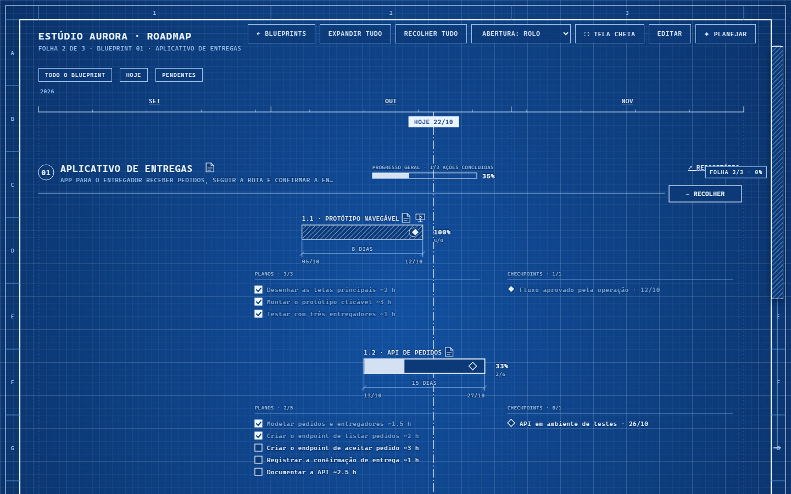

# The Blueprint (beta) — roadmap com folha de projeto, feito para agentes de IA

Um roadmap local-first que o **seu agente** (Claude Code, Codex…) lê e atualiza pelo MCP, e que **você** revisa numa folha de blueprint. O agente propõe, você aplica; o agente marca o que concluiu com evidência, você vê o robozinho andando pela folha.



> **English, in short:** a local-first roadmap app (single Rust binary, SQLite, web UI in a native WebView2 window) that your own coding agent drives over MCP. Workspace → Blueprint → Action → Plan/Checkpoint. Agents *propose* changes (you review and apply them) and *mark* work done only with evidence. The app does not manage agent sessions; the explicit `blueprint claude` command starts Claude Code in the current terminal. Windows is the primary target (window + tray + installer); `blueprint serve` runs the same app as a plain local web server.

## O modelo

```
Workspace
└─ Blueprint            o escopo
   └─ Projeto           agrupa ações dentro do blueprint (opcional; sem projeto, a ação fica em "Geral")
      └─ Ação           início, fim, status, instruções (era "fase")
         ├─ Plano       título, descrição, horas estimadas, feito (era "tarefa")
         └─ Checkpoint  nome, data, feito, evidência (era "marco")
```

Na folha, cada projeto é uma seção numerada (01, 02…) com o cabeçalho de um blueprint e as ações dele abaixo (nasce fechada); as ações são numeradas por projeto (02.3 = projeto 2, ação 3).

- A porcentagem de cada ação e blueprint vem só dos planos e checkpoints marcados.
- **Prazos no ritmo da IA:** plano de 0,5 a 4 h, ação de 1 a 3 dias; o validador avisa de prazo frouxo, apertado ou longo demais, e o app mede o tempo real de cada plano.
- Tudo o que o agente envia é **proposta**: nada muda nos seus dados até você aplicar na tela **✦ Planejar**. Concluir um plano exige **evidência** (comando ou teste rodado e o resultado), que vira comentário do plano.
- O app não manda trabalho a ninguém por conta própria: **você** inicia uma ação, ou digitando `blueprint claude`, ou pelo botão **Iniciar com o Claude** na folha da ação, que pede confirmação (gasta tokens), abre um terminal novo na pasta do blueprint com o Claude Code e o prompt da ação como argumento da sessão nova (nunca por monitor ou canal, e nada vai para uma sessão já aberta). Fora isso o app só mostra o que os agentes informam: o Claude na folha (um por agente e subagente, no plano em que trabalha; o concluído fica até você clicar e ler a mensagem) e o Claude esperando na próxima ação.

## Instalar

**Windows 10/11 (janela, bandeja e instalador)**

- Baixe o instalador `Blueprint-<versão>-instalador.exe` da página de Releases (instala só para o seu usuário, sem administrador), ou
- compile: instale o [Rust](https://rustup.rs) e rode `cargo build --release`; o executável sai em `target/release/blueprint.exe` (cerca de 2,5 MB, a interface vai embutida). O instalador sai de `ISCC instalador\blueprint.iss` (Inno Setup 6).

Os dados ficam em `%APPDATA%\Blueprint\` (banco SQLite `blueprint.db` e `prototipos\`). Para começar com dados de exemplo: `blueprint importar data.exemplo.json %APPDATA%\Blueprint\blueprint.db`.

**Atualizar**

O app procura sozinho uma versão nova nas Releases do GitHub (ao abrir, no máximo uma vez por dia), **baixa o instalador em segundo plano** e confere o SHA-256 contra o `SHA256SUMS` da release. **Nada é instalado sem o seu clique:** quando o instalador está pronto aparece o aviso na janela (e o item "Atualizar para X…" na bandeja); só ao clicar em **Atualizar** o app copia o banco para `%APPDATA%\Blueprint\backups`, roda o instalador em silêncio, fecha e abre de novo. Se houver aviso do agente que a tela ainda não aplicou, ele recusa e diz o porquê (fechar o app o perderia). Na linha de comando: `blueprint atualizar` (procura e baixa), `blueprint atualizar --verificar` (só consulta) e `blueprint atualizar --instalar` (o clique, pelo terminal).

O app só faz um `GET` ao GitHub (sem token, sem identificador, sem telemetria), pelo `curl.exe` do Windows. Para desligar: item "Verificar sozinho ao abrir" na bandeja ou `BLUEPRINT_SEM_ATUALIZACAO=1`; desligado, o app não verifica nem baixa nada. `BLUEPRINT_ATUALIZACAO_SO_ESTAVEL=1` ignora as releases marcadas como pré-lançamento.

**Qualquer sistema (só o servidor)**

```
cargo build --release
./target/release/blueprint serve        # http://127.0.0.1:3000
```

Variáveis do `serve`: `HOST` (padrão 127.0.0.1), `PORT` (3000), `BLUEPRINT_DB` (banco), `DADOS_ARQ` (JSON importado na primeira execução com o banco vazio), `PROTOTIPOS_DIR`, `BLUEPRINT_ASSETS_DIR` (serve `web/` direto da pasta, sem recompilar) e `MCP_REDE=1` (veja [SECURITY.md](SECURITY.md) antes de usar).

Comandos: `blueprint` (janela), `blueprint --version`, `blueprint atualizar [--verificar|--instalar]`, `blueprint serve`, `blueprint --mcp` (MCP por stdio), `blueprint claude [args]` (abre uma sessão Claude com o plugin e a status line; ativa o agente quando a pasta está ligada), `blueprint importar <json> <banco>`, `blueprint exportar <banco> <json>`, `blueprint registrar [--remover]` (instala ou remove o plugin no Claude Code e o MCP no Codex), `blueprint registrar --status-line [--remover]` (status line global opcional) e `blueprint hook sessao|statusline|status|statusline-config` (usados pelo plugin; veja abaixo).

## Claude Code: o plugin do Blueprint

**Com o instalador isso já vem feito**, e `blueprint registrar` repete o passo à mão. Ele instala no Claude Code, para o seu usuário e em qualquer pasta, o plugin `blueprint@blueprint-local`:

- o **MCP** `blueprint` (as ferramentas da tabela abaixo; no Claude elas aparecem como `plugin:blueprint:blueprint`);
- a **skill** `blueprint-planejamento` (o guia de planejar e executar, que o Claude carrega sozinho) e o **agente** `blueprint` (peça com `claude --agent blueprint:blueprint`; não vira o padrão das suas sessões);
- **hooks**: ao abrir uma sessão, o Claude já sabe o blueprint da pasta e a ação atual; a cada edição de arquivo, e quando um subagente começa ou termina, o Claude na folha acompanha no app (só indicador: nada é marcado como concluído sozinho);
- o comando **`/blueprint:status`**: o estado do blueprint da pasta (ação atual, planos e próximo checkpoint).

**Pasta do projeto:** um blueprint novo proposto pelo agente liga a pasta da sessão quando você aplica. Numa pasta sem vínculo, o app oferece a escolha do blueprint; basta selecionar. Em **Editar → Dados do blueprint → Pasta do projeto** você vê, troca, adiciona e remove os vínculos, sem gravar arquivos na pasta.

**Status line:** `blueprint claude` ativa só nessa sessão. Para todas as sessões, use `blueprint registrar --status-line` (opcional e desmarcado no instalador); `blueprint registrar --status-line --remover` restaura a anterior. A instalação guarda `settings.json.bak`, preserva as demais opções e repetições não duplicam a integração. Se já houver um comando, o wrapper executa os dois com o mesmo JSON, conservando sua saída; um pipe simples perderia a entrada da status line. Configura `~/.claude` e também `CLAUDE_CONFIG_DIR` quando definido. Fora das pastas ligadas o Blueprint não imprime nada.

Para testar sem mexer na sua configuração: `node scripts/testar-plugin-claude.mjs <caminho do blueprint.exe>` instala e remove o plugin com pastas temporárias.

**Terminal e avisos:** `blueprint claude` também carrega a marca do app (painel em terminais largos, faixa acima do prompt nos estreitos; `/blueprint-marca` reabre) e o monitor `blueprint watch`, que recebe propostas aplicadas e checkpoints marcados após o app salvar. Os avisos usam texto fixo, filtro pela pasta e limite de 20 por minuto. Veja [o mod](docs/mod-terminal.md) e [os testes e limites do monitor](docs/monitor-e-channels.md).

| | Monitor (padrão) | Channels (opcional) |
| --- | --- | --- |
| Ativação | Plugin, sem flag de canal | `BLUEPRINT_CHANNEL=1` e flag de desenvolvimento |
| Confirmação | Confiança normal do plugin | Confirmação em cada sessão |
| Estabilidade | API experimental de monitors | Research preview |
| Custo | Contexto quando recebe aviso | Contexto quando recebe aviso; substitui o monitor |

Para experimentar com o plugin instalado no PowerShell: `$env:BLUEPRINT_CHANNEL='1'` e `blueprint claude --dangerously-load-development-channels plugin:blueprint@blueprint-local`. Use `Remove-Item Env:BLUEPRINT_CHANNEL` antes da próxima sessão normal. Para MCP registrado diretamente, o identificador é `server:blueprint`. O canal é informativo, sem ferramentas de resposta nem aprovação de permissões. [Comparação e validação real](docs/monitor-e-channels.md).

## Conectar outros agentes (MCP)

No **Codex** (e no Claude Code sem o plugin), ligue só o MCP. O instalador e o `blueprint registrar` já fazem isso no Codex que acharem no PATH. À mão, com o app aberto (ou `blueprint serve` rodando):

```
claude mcp add blueprint -- <caminho>\blueprint.exe --mcp
codex mcp add blueprint -- <caminho>\blueprint.exe --mcp
```

Se o app não estiver em `http://127.0.0.1:3000`, passe `BLUEPRINT_URL` (`claude mcp add blueprint -e BLUEPRINT_URL=http://127.0.0.1:3917 -- …`). A tela **✦ Planejar → Como conectar** mostra o comando exato. Sem o plugin do Claude Code, o agente não sabe sozinho de qual blueprint é a pasta: grave no `CLAUDE.md` ou `AGENTS.md` dela a linha `Blueprint: workspace_id `…`, blueprint_id `…` (MCP `blueprint`).` (o agente descobre os ids com `listar_blueprints`).

**Com o app fechado** o agente continua registrando: `registrar_progresso`, `marcar_concluido`, `marcar_checkpoint_feito`, `propor_blueprint`, `anexar_prototipo` e `vincular_pasta` ficam guardados em arquivos em `%APPDATA%\Blueprint\pendentes\` e, quando o app abre, entram na fila, na ordem, com a mesma validação (a tela os aplica ao abrir o workspace). O que o app recusar na abertura fica em `pendentesecusados\` com o motivo. As ferramentas de leitura (`ler_blueprint`, `listar_blueprints`) precisam do app aberto.

Ferramentas:

| Ferramenta | Para quê |
| --- | --- |
| `listar_blueprints` | workspaces e blueprints, com ids |
| `guia_de_planejamento` | o guia por partes (`planejar`, `editar`, `executar`, `prototipos`) |
| `ler_blueprint` | só a estrutura, ou uma ação inteira (`acao_id`) |
| `propor_blueprint` | propõe ações, planos e checkpoints (parciais completam o que existe; remover é pedido que você aprova) |
| `registrar_progresso`, `reportar_bloqueio` | o que está fazendo agora; aparece na folha como o Claude (uma figura por agente, no plano em que ele trabalha) |
| `marcar_concluido`, `marcar_nao_concluido` | plano concluído (com evidência) ou não |
| `marcar_checkpoint_feito`, `marcar_checkpoint_nao_feito` | idem para checkpoints |
| `anexar_prototipo` | protótipo HTML autocontido de uma ação, visto num visor isolado |
| `vincular_pasta` | liga a pasta da sessão a um blueprint (o app guarda o vínculo) |

O guia que o agente lê está em [`skills/blueprint-planejamento/`](skills/blueprint-planejamento/SKILL.md).

## Desenvolver e testar

```
cargo dev                                    # o app em modo dev, com recarga automática (precisa do cargo-watch)
```

`cargo dev` abre a janela do app com os seus dados (`%APPDATA%\Blueprint`), então feche o app antes. Salvou `web/`, `kit/` ou `blueprint.html`: a janela recarrega (CSS troca sem perder a tela; F12 abre as ferramentas). Salvou `src/`, `skills/` ou `Cargo.toml`: o `cargo-watch` (`cargo install cargo-watch`, uma vez) recompila e reabre. Sem ele: `cargo run -- dev`. Para trabalhar no navegador com dados de exemplo, sem Node na janela: `node dev.mjs` (http://127.0.0.1:3917; opções `--porta N`, `--limpar`, `--abrir`).

```
cargo test                                   # 95 testes (92 fora do Windows): dados, validação, MCP, HTTP
node emblemas.test.mjs                       # marcas e figuras (kit do anatomy)
node agentes-figura.test.mjs
node scripts/migrar-vocabulario.test.mjs
```

Verificações de ponta a ponta (precisam do `target/release/blueprint.exe` e, as de tela, do Microsoft Edge): `scripts/contrato-http.mjs`, `fumaca-rust.mjs`, `ui-e2e.mjs`, `robo-e2e.mjs`, `painel-agentes-e2e.mjs`, `capturas.mjs --comparar`, `mutacoes.mjs` (quebra as regras de segurança de propósito e confere que algum teste falha) e `testar-instalador.mjs`. Veja [CONTRIBUTING.md](CONTRIBUTING.md).

## Desempenho (medido)

Binário de 2,5 MB, servidor com ~11 MB de memória e 0% de CPU em repouso, `GET /api/dados` abaixo de 5 ms, janela visível em ~0,1 s. Detalhes em [`referencias/relatorio-medicao.md`](referencias/relatorio-medicao.md).

## Segurança

As rotas `/api/mcp/*` só respondem em loopback e conferem `Host` e `Origin`; os protótipos rodam num `iframe` com sandbox de origem opaca e sem rede. Leia [SECURITY.md](SECURITY.md).

## Licença

[MIT](LICENSE). O kit isométrico descende do [Anatomy](https://github.com/wheresryan22/anatomy) (MIT); veja [NOTICE.md](NOTICE.md).
